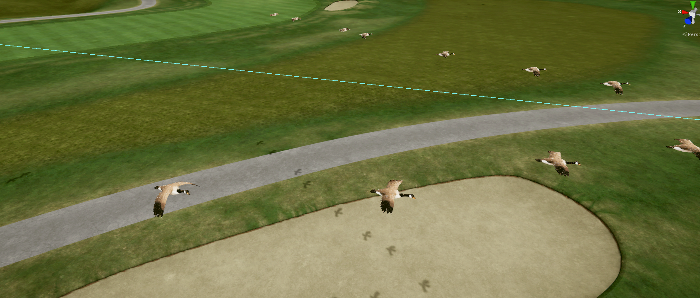

# Bird Flock

## Description

Moves bird flocks (or any prefab you supply) along waypoints through your
scene, using the same path/spawner/baker system as
[Moving Vehicles](https://github.com/mmoore0011/chickenandribs_movingvehicles) —
just adapted for flight instead of roads. Works two ways:

- **Built-in birds**: low-poly geese-style birds generated entirely from
  code, arranged in an asymmetric V formation (one wing longer than the
  other, with 1-2 stragglers) that re-rolls a little differently on every
  spawn so flocks don't look mechanical.
- **Your own prefabs**: supply 1-6 custom prefabs instead, each flock
  slot picks one at random. **Animated prefabs are fully supported** —
  if your bird prefab has its own Animator (wing flaps, etc.), that
  animation keeps playing independently; baking only captures the
  flock's *path* movement, it doesn't touch or replace your prefab's own
  animation. There's also a "Single Object" mode for placing one
  pre-animated prefab at the path's spawn point instead of a formation —
  useful for a pre-built murmuration effect, for example.

## Installation

**Option A — import the `.unitypackage`** (easiest): download the latest
`.unitypackage` from this repo's
[Releases page](https://github.com/mmoore0011/chickenandribs_birdflock/releases/latest),
then in Unity: **Assets → Import Package → Custom Package…** and select
the downloaded file.

**Option B — copy into your project**: copy `Assets/BirdFlock` into your
Unity project's `Assets` folder; Unity compiles it automatically.

## Step-by-Step Instructions

### 1 — Create the flight path

1. **GameObject → Create Empty** → rename it `BirdFlightPath`.
2. **Add Component → Bird Path**.
3. Use the custom Inspector's **+ Add Waypoint** / **Remove Last** /
   **Select** buttons, and drag the orange position handles in the Scene
   view to place each waypoint **at the altitude you want birds to fly**.

> Use **Snap All Waypoints to Terrain**, then set **Altitude Above
> Surface** (default 20 m), to lift ground-snapped waypoints to a
> realistic flying height in one step. Put `Waypoint_00` and the last
> waypoint behind terrain or at the edge of render distance so flocks
> appear/disappear off-screen naturally.

### 2 — Add the spawner

1. **GameObject → Create Empty** → rename it `BirdSpawner`.
2. **Add Component → Bird Spawner**.
3. Drag `BirdFlightPath` into the **Bird Path** field.
4. (Optional) Create an empty `Flocks` GameObject and drag it into
   **Flock Parent** to keep spawned flocks tidy in the Hierarchy.

### 3 — Choose built-in birds or your own prefabs

- Leave **Use Built-In Birds** checked for the procedural geese.
- Uncheck it and assign 1-6 of your own prefabs to **Custom Bird
  Prefabs** to use those instead — each flock slot picks one at random.
- Set **Flight Pattern** to **Single Object** instead of **V Formation**
  if you want one custom prefab placed at the path's spawn point rather
  than a multi-bird formation.

### 4 — Tune the settings

| Field | Default | Effect |
|---|---|---|
| Number of Birds | 14 | Birds per flock (3-50) |
| Min / Max Interval | 240 / 720 s | Random wait before the next flock spawns (shown with a human-readable hint like "4.0 minutes") |
| Min / Max Speed | 8 / 14 m/s | ~29-50 km/h, typical geese cruising speed |
| Speed Variation | 0.3 | How much speed varies along the path when baked (0 = constant) — has no effect at runtime, bake-only |
| Bird Audio Clip / Volume / Max Distance | — | Optional sound played on each spawned flock (if the prefab itself already has an AudioSource with a clip, that one takes priority) |

### 5 — Hit Play

Flocks appear at the spawn point and fly to the despawn point, then
remove themselves silently.

### Making multiple flight paths

Add more `BirdSpawner` + `BirdPath` pairs, one per path — each is fully
independent with its own random timing.

### Exporting to GSPro (bake workflow)

Same reasoning as Moving Vehicles: GSPro's course format can't include
custom MonoBehaviour scripts, so the runtime spawner alone won't work
there. Bake first:

1. Set up your path and spawner as above, verify it in Play mode.
2. **Stop Play mode** (baking must run in Edit mode).
3. **Tools → chickenandribs → Bird Flock → Bake All Flocks in Scene** —
   saves bird meshes/materials as project assets and converts flock
   movement into AnimationClips (Unity's built-in Animation component,
   no custom scripts needed at GSPro runtime). Two flocks are baked per
   spawner with staggered timing so a new one appears roughly every
   `(travelTime + avgInterval) / 2` seconds.
4. Save the scene, then export your course as normal.

To iterate: **Tools → chickenandribs → Bird Flock → Clear Baked Flocks**
removes baked flocks and re-enables the live spawner.

## Troubleshooting

- **Built-in birds have no wing animation** — intentional; the
  procedural birds are static low-poly geometry, meant for background
  use at a distance. If you want wing animation, supply your own
  animated prefab instead (see step 3) — baking won't interfere with it.
- **No collision** — flocks pass through each other and through
  geometry; at typical flying altitude/distance this isn't noticeable.
- **Custom prefab's animation doesn't play after baking** — baking only
  adds a path-movement AnimationClip to the flock container; it doesn't
  touch your prefab's own Animator. If it stopped working, check that
  the prefab's own Animator Controller and Avatar are still assigned
  correctly on the prefab itself, independent of this tool.

## Feature Requests / Bug Reports

Please open an issue in this repository.
